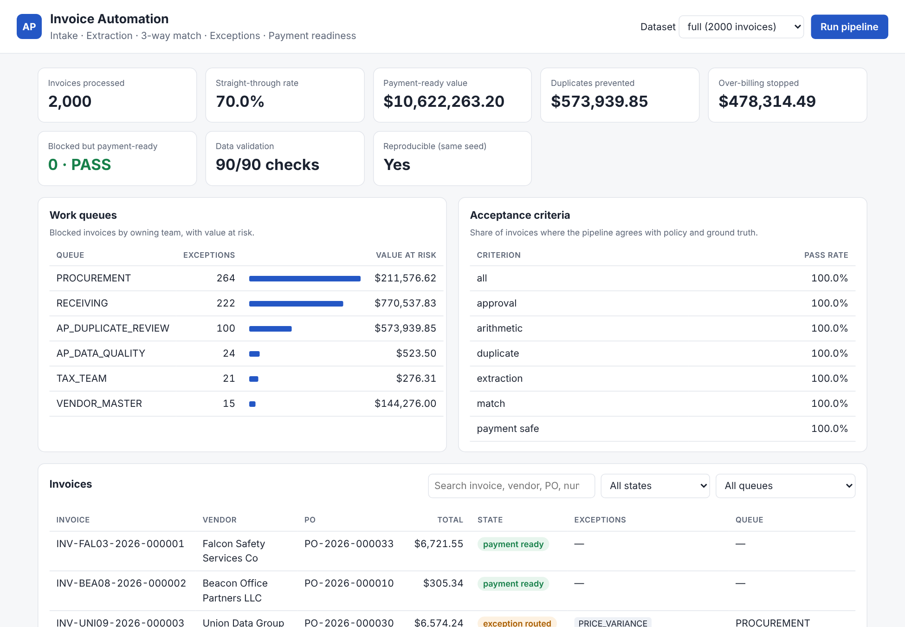

# AP Invoice Automation: intake → extraction → 3-way match → exception routing → payment readiness

A working accounts-payable automation pipeline, plus a reproducible synthetic data generator and an
evaluation harness that scores every decision against a separate ground truth.

```
raw invoice documents ──► extract fields ──► duplicate gate ──► header checks ──► 3-way match (PO ↔ receipt ↔ invoice)
     (3 layouts)            (regex, typed)    (vendor+number)    (vendor, totals,    (price / qty / tax,
                                                                  tax, dates)          cumulative billing)
                                                                        │
                                       ┌────────────────────────────────┴───────────────┐
                                exceptions found                                  no exceptions
                                       │                                                │
                          route to work queue with reason                approval matrix (tier 1-3)
                          (PROCUREMENT, RECEIVING, TAX_TEAM, ...)                       │
                                       │                                        PAYMENT_READY
                                  BLOCKED (never payable)                 (hard guard in code)
```



Every state change is written to an append-only audit log (`invoice_events.csv`), and every blocked invoice
carries a plain-English explanation with expected vs actual values.

## Results on the full dataset (seed 20261022)

| Metric | Value |
|---|---|
| Invoices processed | 2,000 |
| Straight-through (touchless) rate | 70.0% |
| Acceptance criteria met (all five, per invoice) | 100% |
| Blocked invoices marked payment-ready | **0** (safety gate PASS) |
| Duplicate payments prevented | $573,939.85 |
| Over-billing stopped (price + quantity) | $478,314.49 |
| Data validation checks | 90 / 90 pass |
| Same seed, regenerated twice | 26/26 files byte-identical |

> These scores are high because the documents are machine-rendered and the rules are known. The
> [robustness test](#beyond-the-brief-three-extras) below shows what happens when documents are damaged.

## Beyond the brief: three extras

The brief asks for data, rules and validation. These three go further, because a real customer would ask
"what if the documents are messy?", "how strict should the rules be?" and "what is it worth?".

**1. Robustness test** (`python -m apflow robustness`, report in `docs/results/robustness.md`).
900 documents are damaged on purpose (wrong digit, letter instead of digit, missing total, blank PO number,
messy line endings). The result that matters is **unsafe payments: 0**. The test also found two real weaknesses
that are now fixed:

* A goods invoice with an unreadable PO number was treated as a non-PO invoice and **skipped the 3-way match**
  (41 unsafe payments). It is now blocked with `PO_REQUIRED`; only service SKUs may be billed without a PO.
* Windows line endings broke extraction completely. Text is now normalised, and an item line that cannot be read
  raises an error instead of being silently dropped.

**2. What-if simulator** (`python -m apflow whatif`, `docs/results/whatif.md`).
Replays the same invoices under price tolerances from 0% to 10%. At 0%, 112 good invoices need a person. At 10%,
64 price variances slip through and $38.8K of overcharge is paid. The current 2% blocks no good invoices and
misses no variances. The trade-off is visible, so the process owner can pick the number.

**3. Business impact estimate** (`python -m apflow impact`, `docs/results/impact.md`).
Combines measured results with assumptions (minutes per invoice, hourly cost) that are kept in
`backend/config/assumptions.json` and labelled as assumptions. Replace them with the customer's numbers.

## Project structure

```
backend/     Python: pipeline (apflow/), business policy (config/), web API (api.py), tests/
frontend/    Web dashboard: index.html, app.js, styles.css (plain JavaScript, served by the API)
database/    MariaDB schema, MariaDB loader script, analyst SQL queries
data/        Generated datasets (input / reference / ground_truth / sql) for `starter` and `full`
output/      Pipeline results per dataset, including the SQLite DB the API reads
docs/        Architecture and data dictionary
```

## Quick start (Windows, macOS or Linux)

You need Python 3.10 or newer.

```bash
git clone <your-repo-url>
cd <repo-folder>
python -m venv .venv
# Windows:  .venv\Scripts\activate        macOS/Linux:  source .venv/bin/activate
pip install -r backend/requirements.txt

cd backend
python -m pytest -q                               # 67 tests
python -m apflow all --scale 0.1 --name starter   # small dataset: ~1 second
python -m apflow all                              # full dataset: 300 vendors, 2,000 invoices

python -m uvicorn api:app                         # start the web dashboard
```

Open **http://127.0.0.1:8000** for the dashboard, or **http://127.0.0.1:8000/docs** for interactive API docs.
A static report is also written to `output/full/report.html`.

### Web dashboard

* KPI cards: touchless rate, payment-ready value, duplicates prevented, safety gate, validation
* Work queues with value at risk per team
* Invoice list with search and filters (state, queue)
* Click an invoice to see why it was blocked, expected vs actual values, matched receipts,
  its full audit trail and the original document
* "Run pipeline" button regenerates the data and reruns everything

### API endpoints

| Method | Path | Purpose |
|---|---|---|
| GET | `/api/summary?dataset=full` | KPIs, acceptance, detection metrics, validation, reproducibility |
| GET | `/api/invoices?state=&queue=&exception=&search=&limit=&offset=` | Paged, filtered invoice decisions |
| GET | `/api/invoices/{invoice_id}` | Decision, exceptions, audit trail, lines, receipt matches, raw document |
| GET | `/api/queues` | Exceptions and value at risk per queue |
| GET | `/api/datasets` | Available datasets |
| POST | `/api/pipeline/run` | Generate, validate, run, evaluate and reproduce (`{"name": "starter", "scale": 0.1}`) |

### CLI commands (run inside `backend/`)

| Command | What it does |
|---|---|
| `python -m apflow generate [--scale 0.1] [--seed N] [--name X]` | Build the synthetic dataset into `data/<name>/` |
| `python -m apflow validate` | 90 checks: keys, joins, enums, dates, arithmetic, lifecycle, duplicates, labels |
| `python -m apflow run` | Run the automation; write decisions, exceptions, events and a SQLite DB to `output/<name>/` |
| `python -m apflow evaluate` | Score against ground truth; write `metrics.json` and `report.html` |
| `python -m apflow whatif` | Replay invoices under different price tolerances |
| `python -m apflow robustness` | Damage documents on purpose and check no wrong payment results |
| `python -m apflow impact` | Business impact estimate from results + `assumptions.json` |
| `python -m apflow reproduce` | Generate twice with the same seed and compare SHA-256 checksums |
| `python -m apflow explain INV-UNI09-2026-000003` | Print the decision and full audit trail for one invoice |
| `python -m apflow docs` | Regenerate `docs/data_dictionary.md` from the schema |
| `python -m apflow all` | generate → validate → run → evaluate → whatif → robustness → impact → reproduce |

All commands accept `--scale`, `--seed`, `--name` and `--policy`. The default name is `full` at scale 1.0.

## Who uses what

| Actor | What they get |
|---|---|
| Business requester | PO and receipt context on each exception (requester, cost centre) |
| Process owner | `backend/config/policy.json`: tolerances, tax codes and approval limits change without code edits |
| Approver | Approval tier and roles per invoice (`approval_decisions.csv`) |
| Operations analyst | Web dashboard: work queues, reasons, audit trail, value at risk; SQL queries in `database/` |
| System administrator | Validation summary, checksum manifest, reproducibility report, CI tests |

## Business rules

| Check | Rule (from `config/policy.json`) | Exception → queue |
|---|---|---|
| Duplicate | same vendor + normalised invoice number (`abc-26-0012` = `ABC260012`) | `DUPLICATE_EXACT` / `DUPLICATE_NUMBER` → AP_DUPLICATE_REVIEW |
| Vendor | vendor must be active on the invoice date | `VENDOR_INACTIVE` → VENDOR_MASTER |
| Totals | subtotal = Σ lines; total = subtotal + tax (±0.01) | `TOTAL_MISMATCH` → AP_DATA_QUALITY |
| Dates | invoice date ≥ PO date | `DATE_BEFORE_PO` → AP_DATA_QUALITY |
| Tax | tax code = PO line tax code; stated tax = Σ round(line × rate) | `TAX_MISMATCH` → TAX_TEAM |
| PO reference | goods invoices must reference a PO; only service SKUs (`SKU-SRV-`) may be billed without one | `PO_REQUIRED` → PROCUREMENT |
| Receipt | an invoiced PO line must have a goods receipt | `MISSING_RECEIPT` → RECEIVING |
| Quantity | cumulative billed ≤ ordered, and ≤ received | `QTY_EXCEEDS_PO` → PROCUREMENT, `QTY_EXCEEDS_RECEIVED` → RECEIVING |
| Price | invoice unit price ≤ PO price × 1.02 | `PRICE_VARIANCE` → PROCUREMENT |
| Approval | ≤ $10k auto; ≤ $100k manager; above that, manager + controller; non-PO always needs a human | — |
| Payment | only exception-free, fully approved invoices; due = invoice date + vendor terms | — |

If an invoice has several exceptions, the primary queue follows a documented precedence (duplicate first,
price last) in `backend/apflow/policy.py`.

## Synthetic data

| Entity | Rows | Notes |
|---|---|---|
| Vendor | 300 | Pareto-skewed activity; 1–2 categories; EMAIL/PORTAL/EDI channel; some CLOSED |
| PurchaseOrder / Line | 1,500 / 2,200 | 1–8 lines; SKU, qty, price and tax code from a 400-SKU catalogue |
| GoodsReceipt / Line | 1,800 / ~2,350 | full, partial, over-receipt, split shipments, none |
| Invoice / Line | 2,000 / ~2,400 | rendered as raw text documents in 3 layouts |
| Approval / Payment | ~1,410 / 1,400 | only for eligible invoices |

Scenario mix (exact, by largest-remainder allocation): 70% clean, 10% price variance, 8% quantity mismatch,
5% duplicates, 4% missing receipt, 3% tax/vendor/data errors. All eight required edge cases are present and
labelled, plus boundary cases that **must pass**: price within tolerance, partial delivery billed at the received
quantity, over-receipt billed at the PO quantity, and non-PO invoices.

How the data stays honest:

* **Parents before children.** Vendors → POs → lines → receipts → invoices. Totals, statuses and dates are
  derived from source records, never drawn at random.
* **Labels come from rules.** The generator records which scenario it injected; the expected exceptions,
  match status, queue, approval roles and payment readiness are derived from one rule table
  (`EXPECTED_EXCEPTIONS` in `backend/apflow/policy.py`).
* **No leakage.** `data/<name>/input/` holds master data and raw documents only. The pipeline never reads
  `reference/` or `ground_truth/`.
* **Reproducible.** One seed (`20261022`), no unordered iteration, LF line endings, SHA-256 manifest.
* **Lawful provenance.** 100% synthetic, with no external datasets. Tax IDs use IRS-unissued EIN prefixes so they
  cannot match a real company.

Exports per dataset: CSV and JSON for every table, `invoice_documents.jsonl`, MariaDB `sql/schema.sql` and
`sql/seed.sql`, `ground_truth.csv/json`, `manifest.json`, `validation_summary.md/json`.

Load into MariaDB (optional): `cd database; .\\load_mariadb.ps1 -Dataset full -User root` (see `database/README.md`).

## Backend layout

```
backend/api.py              FastAPI web API + serves the frontend
backend/config/policy.json  business policy: volumes, mix, tolerances, tax codes, approval matrix
backend/apflow/
  schema.py                 data dictionary as code -> validation, SQL DDL, docs
  policy.py                 exception catalogue, precedence, queues, lifecycle transitions
  generator/                synthetic data (catalog, build, document rendering)
  pipeline/extraction.py    layout detection + field extraction
  pipeline/engine.py        duplicate gate, validation, 3-way match, routing, approval, payment guard
  pipeline/run.py           runs everything, writes CSVs + SQLite
  validation.py             90 dataset checks
  evaluation.py             metrics vs ground truth + acceptance criteria
  report.py                 static HTML report
backend/tests/              unit, rule-level, end-to-end, negative and API tests
```

## Limitations

* **Extraction is rule-based on machine-rendered text.** It scores 100% on clean documents and fails safely on
  damaged ones (see the robustness test), but real scans or PDFs would need OCR or an LLM extractor behind
  `extract()`. The evaluation harness would score that the same way.
* **The synthetic price variances are either under 1.5% or over 3%**, so the what-if results for 2% and 3% are
  identical. Real data would be smoother.
* **Business impact figures depend on assumptions**, not measurements. They are labelled as such.
* **Human approvals are simulated** (always approved, flagged `simulated=true`) so the flow can be measured end
  to end.
* Single currency (USD) and one fiscal year.

## Notes from the author

I used Claude (an AI assistant) while building this project. I reviewed the rules, ran the tests, and checked the
results myself. My own design decisions are written down in [`docs/decisions.md`](docs/decisions.md).
A two-minute demo script is in [`docs/DEMO.md`](docs/DEMO.md).

See `docs/architecture.md` for the design and `docs/data_dictionary.md` for every field.
