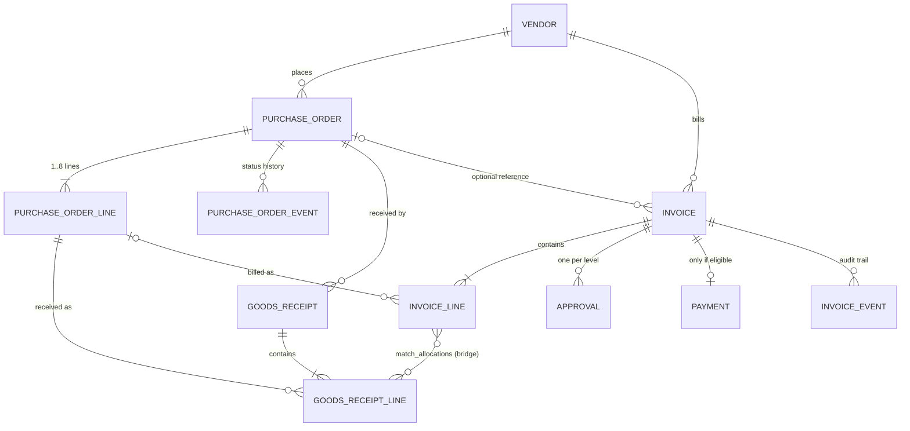

# Architecture

## Entity relationships



* **N:M** invoice line ↔ receipt line is resolved by the `match_allocations` bridge (FIFO allocation of billed
  quantity to receipts, oldest first).
* **Optional:** `invoice.po_id` (non-PO service invoices), `invoice_line.po_line_id`, `vendor.closed_date`.
* **Effective dates:** `vendor.onboarded_date` / `closed_date`; PO status history in `purchase_order_events`.

## Lifecycles (append-only, validated)

```
Invoice:  RECEIVED → EXTRACTED → VALIDATED → MATCHED → APPROVAL_PENDING → APPROVED (×levels) → PAYMENT_READY
                    ↘ EXCEPTION_ROUTED (extraction failed)
                                ↘ DUPLICATE_BLOCKED
                                            ↘ EXCEPTION_ROUTED (any rule failed)
PO:       CREATED → PARTIALLY_RECEIVED → RECEIVED
```

Transitions are defined once in `backend/apflow/policy.py`. Tests assert that every invoice's history follows them.

## Processing order and why

1. **Duplicate gate first.** A duplicate must not consume PO quantity or receipts, or it would hide a real
   over-billing on the next invoice. Duplicates short-circuit everything else.
2. **Header checks** (vendor active, totals, tax arithmetic, date vs PO). These are cheap, and they catch errors
   that make line matching meaningless.
3. **Three-way match per line.** Quantities are checked **cumulatively** across invoices, so split billing works
   and double billing across two different invoice numbers is still caught.
4. **Routing.** All exceptions are recorded; the primary one (by precedence) picks the queue.
5. **Approval and payment.** `_mark_payment_ready()` raises `PaymentSafetyError` if anything tries to release an
   invoice that has exceptions or missing approvals. The control lives in code, not convention.

## Separation of concerns

| Folder | Read by the pipeline? | Purpose |
|---|---|---|
| `data/*/input/` | yes | master data + raw documents |
| `data/*/reference/` | no | structured invoice source, generated approvals/payments (answer key) |
| `data/*/ground_truth/` | no | expected labels and decisions |
| `output/*/` | written by the pipeline | decisions, exceptions, events, allocations, SQLite, report |

## Extending

* **Real documents:** replace `backend/apflow/pipeline/extraction.extract()` with OCR or an LLM that returns an
  `ExtractedInvoice`. Nothing else changes, and `backend/apflow/evaluation.py` reports field-level accuracy.
* **Policy changes:** edit `backend/config/policy.json` (tolerance, approval limits, mix, volumes) and rerun.
* **New rule:** add a code to `EXCEPTIONS` and `PRECEDENCE` in `policy.py`, implement the check in `backend/apflow/pipeline/engine.py`,
  and add a test in `backend/tests/test_engine.py`.
